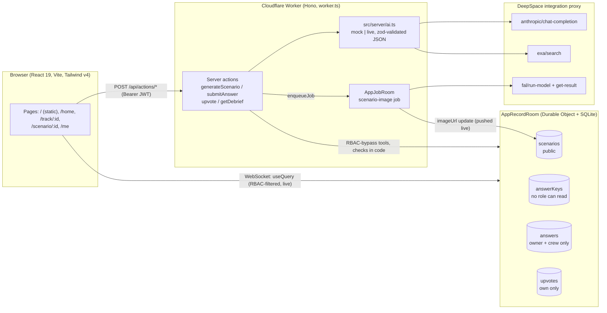

# Orbit Lab

**Live:** https://orbit-lab.app.space

Orbit Lab is a scenario-based space-science learning app built on the
[DeepSpace SDK](https://docs.deep.space). You pick a track, read a realistic
mission briefing, write what you would do, and get graded feedback grounded in
real NASA and ESA sources. After you submit, the Crew Log shows how everyone
else answered the same scenario, live, and you can upvote the best
explanations. It is not a game: no timers, no leaderboards.

Tracks: ISS Operations, Spacecraft & Launch, Orbits & Gravity, Black Holes &
Stars, Planets.

## How it works

1. **Brief.** "Request briefing" returns the oldest scenario in the track you
   have not answered yet. Only when you have answered all of them is a new one
   generated: exa finds 2-3 reputable sources, Claude writes the scenario from
   them as strict JSON, and fal paints an illustration in the background.
   Each scenario is generated once and shared by everyone.
2. **Transmit.** You answer in up to 1500 characters, once per scenario.
3. **Debrief.** Claude grades your answer against a server-only rubric and
   expert answer. You get a score ring, what you got right, what you missed,
   the expert approach, and the sources.
4. **Crew Log.** Only now can you read the other answers for that scenario.
   New answers and upvotes arrive live. It is anonymous: other people appear
   as "Crew member N" (N = the order they answered that scenario, from 1),
   and your own entry as "You". Your Progress page is private to you.

## Architecture



- **One database:** DeepSpace's synced records (RecordRoom). No external DB,
  ORM, or separate backend.
- **All writes go through server actions.** No collection accepts client
  writes, so validation (1500 chars, one answer per user, no self-upvote,
  you must have answered before voting) lives in one place, backed by
  `uniqueOn` constraints in the Durable Object.
- **Answer keys** have `read: false` for every role, including the app owner,
  so they are never synced to any browser. The key comes back only in the
  `submitAnswer` response, after your answer is saved, or from `getDebrief`
  if you have already answered.
- **Crew Log visibility** is enforced by the Durable Object, not the UI. Each
  answer carries a `crew` list (every user who has submitted for that
  scenario) declared as the schema's `collaboratorsField`, with
  `read: 'shared'`. `submitAnswer` keeps the list in sync. The DO re-checks
  read access on every change and pushes newly readable answers to connected
  clients, which is what makes the Crew Log live.
- **Anonymous Crew Log, enforced on the wire.** Answers store no author
  name, only the opaque `userId` the access rules need; labels are computed
  in the browser from submission order (`src/lib/crew.ts`). The users schema
  sets `roster: 'read-policy'`, so the SDK's `user.list` roster sends each
  member only their own row instead of every user's `{ id, name }`, which
  would otherwise let anyone map a `userId` back to a name. The 3-user e2e
  test asserts that no browser receives another user's name or email.
- **Integrations** are called only server-side through the DeepSpace proxy.
  No provider SDKs, no API keys in the app, and the scaffold default that
  every integration requires a signed-in caller is kept.

Key files:

| Path | What |
| ---- | ---- |
| `src/schemas/orbit-schemas.ts` | Collections and RBAC |
| `src/actions/*` | Server actions (`crew.ts` = Crew Log access sync) |
| `src/server/ai.ts` | Only module that talks to integrations; mock/live switch |
| `src/server/mock-data.ts` | 2 realistic scenarios per track for mock mode |
| `src/jobs.ts` | Background image job |
| `src/components/mission`, `crew`, `progress`, `space` | UI components |
| `DESIGN.md` | Design system (palette, type, motion, component sketches) |
| `NOTES.md` | Decision and bug log for every phase |

## Integrations used and why

| Integration | Endpoint(s) | Why |
| ----------- | ----------- | --- |
| Anthropic | `anthropic/chat-completion` (`claude-sonnet-5-5`) | Writes scenarios and grades answers. Output must be strict JSON, validated with zod, retried once with the validation error, then a friendly error. |
| Exa | `exa/search` | Finds 2-3 sources on an allowlist of reputable domains (nasa.gov, esa.int, eso.org, stsci.edu, universities) so scenarios are grounded and citable. Re-checked server-side (https, allowlist, no PDFs). |
| fal | `fal/run-model`, `fal/get-result` (`fal-ai/flux/schnell`) | One cinematic illustration per scenario, generated in a background job so it never blocks the page. Any failure keeps a gradient fallback. |

Exact request and response shapes, taken from `npx deepspace integrations
info`, are recorded in `NOTES.md`.

## Run locally

Requirements: Node 22.15+, 24, or 26; npm 11.6+; a DeepSpace account.

```bash
npm install
npx deepspace auth login        # browser OAuth
npx deepspace dev start         # http://localhost:5173
```

The AI mode is a plain variable in `wrangler.toml`:

```toml
AI_MODE = "live"          # "mock" = canned data, no network, no cost
AI_MOCK_BAD_JSON = "false" # mock only: "true" forces malformed model output
```

Tests:

```bash
npx deepspace test accounts create --email you-a-<id>@deepspace.test --name "Crew A" --password-stdin
# ...also "Crew B" and "Crew C" (emails are global, so add a unique suffix)
npx deepspace test run e2e      # Playwright: core loop, 3-user Crew Log, progress, smoke
npx vitest run                  # unit tests: src/server/ai.ts, src/lib/crew.ts
```

On Windows, run `vitest` from the canonical drive-letter case (for example
`D:\space`, not `d:\space`); see NOTES.md, Phase 2.

Production checks (signed-in test accounts against any origin):
`node tests/tools/prod-smoke.mjs`, `prod-crew.mjs`, `prod-live.mjs`,
`prod-security.mjs`.

Deploy: `npx deepspace deploy`. This app's source of truth is GitHub
(`vaishnavi1064/orbit-lab`), claimed on the first deploy.

## What was left out, and why

- **ElevenLabs narration of briefings.** Listed as a stretch goal; I spent
  the time on the core loop and the security checks instead. The endpoint
  shape is recorded in NOTES.md for later.
- **Persisting images to R2.** fal CDN URLs are not guaranteed permanent. The
  image falls back to the gradient if a URL dies; copying images into R2
  would remove the risk but was not required by the spec.
- **Un-voting.** The spec asks for `upvote(answerId)` only.
- **Per-scenario rooms for the Crew Log.** Keeping crew lists on each answer
  costs O(n) writes per submit, which is fine at this scale and needs no
  extra room types.
- **Moderation and admin tools, payments, real-time chat, native apps.** Out
  of scope by design (see SPEC.md non-goals).
